# Pinkie Pie's Balloon Palace (the spatial audio Balloon Shop): help

This is the same guide you'll find inside the plug-in: click **help** in the top right corner to open the library, where Twilight reads in the corner.

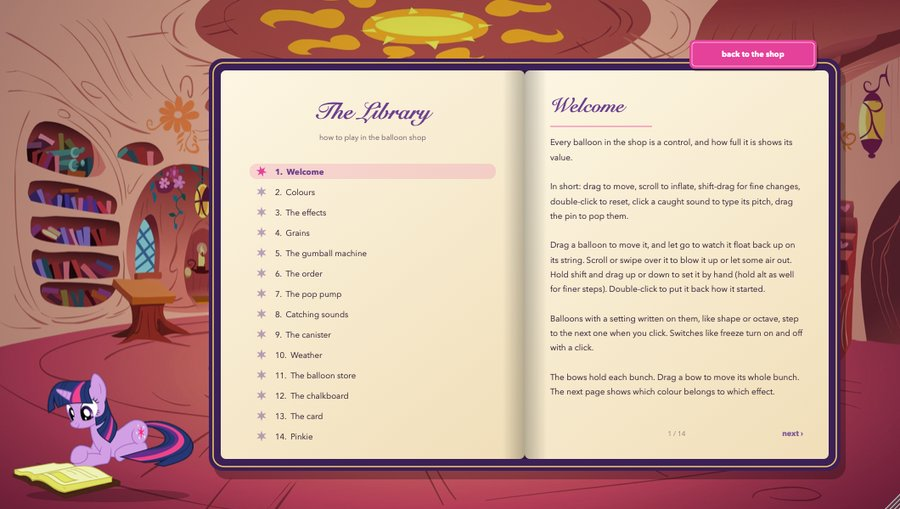
There's also a [PDF manual](manual/Pinkie%20Pies%20Balloon%20Palace%20Manual.pdf) with all of this and more.

## Contents

- [Welcome](#welcome)
- [The sphere](#the-sphere)
- [Grains in the sphere](#grains-in-the-sphere)
- [Flying](#flying)
- [Out](#out)
- [Colours](#colours)
- [The effects](#the-effects)
- [Grains](#grains)
- [The gumball machine](#the-gumball-machine)
- [The order](#the-order)
- [The pop pump](#the-pop-pump)
- [Catching sounds](#catching-sounds)
- [The canister](#the-canister)
- [Weather](#weather)
- [More weather](#more-weather)
- [Sonic rainboom](#sonic-rainboom)
- [The balloon store](#the-balloon-store)
- [The gumball menu](#the-gumball-menu)
- [The chalkboard](#the-chalkboard)
- [The card](#the-card)
- [Pinkie](#pinkie)

## Welcome

Every balloon in the shop is a control, and how full it is shows its value.

In short: drag to move, scroll to inflate, shift-drag for fine changes, double-click to reset, click a caught sound to type its pitch, drag the pin to pop them.

Drag a balloon to move it, and let go to watch it float back up on its string. Scroll or swipe over it to blow it up or let some air out. Hold shift and drag up or down to set it by hand (hold alt as well for finer steps). Double-click to put it back how it started.

Balloons with a setting written on them, like shape or octave, step to the next one when you click. Switches like freeze turn on and off with a click.

The bows hold each bunch. Drag a bow to move its whole bunch. The next page shows which colour belongs to which effect.

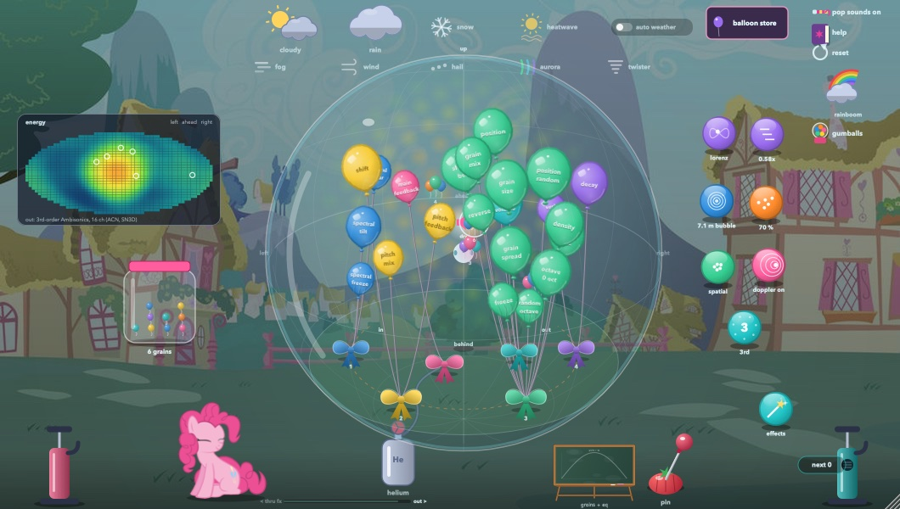

## The sphere

The shop is inside a glass sphere now, and you're the little head in the middle, looking ahead into the screen. The bows stand on a ring round its floor, in the order the sound goes through the effects, and their balloons float up inside it.

Drag the empty glass to turn the sphere round and look at it from anywhere. Turning it only changes your view, never the sound.

Scroll or pinch on the empty glass to zoom in, towards wherever the cursor is: the balloons grow so they're easy to read and edit, and the room behind blurs and darkens. Double-click the glass to set the view back.

The words on the glass show which way is ahead, left, right, behind and up. The glow on the glass and the map at the top left show where the sound is loudest, like the IEM EnergyVisualizer: red is the loudest place, then yellow, green and blue.

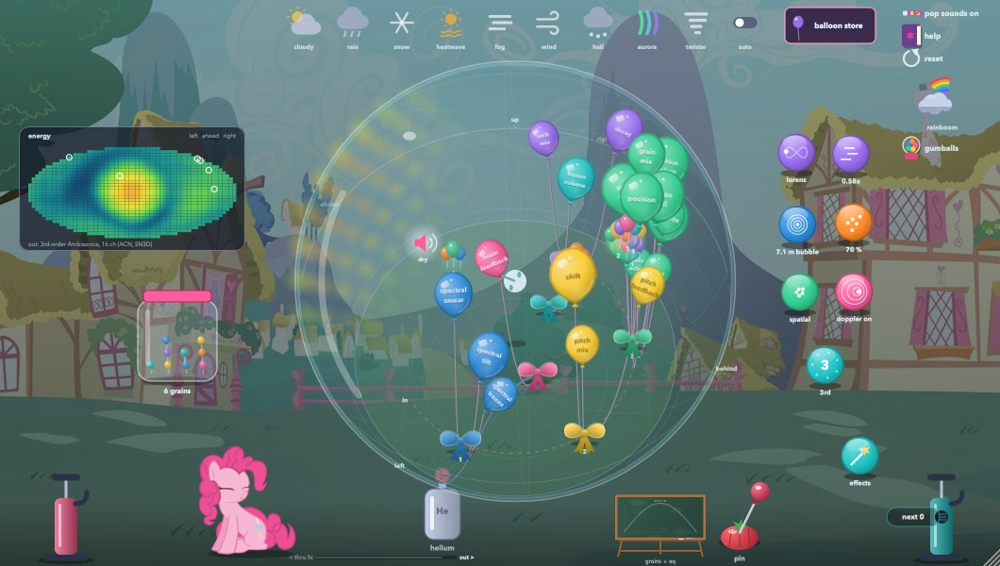

## Grains in the sphere

The little bouquets flying in the sphere are grains. Click the jar on the left for another one, or drag one out of the jar and drop it where you want it. Drag a grain back onto the jar, or right-click the jar, to take one away. You can have up to 16.

Your own sound, dry, plays from one place: the little pink loudspeaker. Drag it anywhere in the sphere.

The grains token on the right picks how the effects use the grains. On spatial, every grain carries its own copy of the effects (the smear, the pitch shifter, the gumball machine and what you bought), and each copy's sound plays at its grain as a point, so you can hear where each one is. The granulator (the mint balloons) is a cloud of short grains, each one born at its own direction round one of the grains, like the IEM GranularEncoder: grain spread sets how far round its grain each one may land, from exactly there to anywhere on the sphere. On scatter there's only one copy of the effects, at the first grain, and the granulator's grains still go to all of them. On copies, every grain is the whole shop, your dry sound and all, the way the sphere first worked.

Deviate is how far the copies stray from your settings. The first grain always plays your settings as they are; the others drift away slowly, each its own way, and now and then freeze or let go by themselves. In the granulator it makes every grain's length, start and pitch a little different. Every sound in the sphere is a single point, so you can always tell where it is.

A grain glows with its sound, hops when it stutters and frosts over when it freezes.

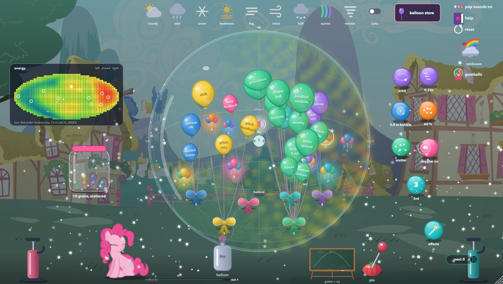

## Flying

The flight token picks how the grains move, and speed sets how fast.

Still keeps each grain where you dropped it. Orbit sends each one round you on its own tilted ring. Lorenz flies them along the Lorenz attractor, the butterfly, each one starting somewhere else on it. Flock makes them a flock of birds (boids): they keep apart, line up and stay together. Random picks a new place every so often and glides there. Spiral winds them round you, climbing and sinking. Lissajous traces looping figures, each grain at its own rates. Rossler flies them on the Rossler attractor, a loose coil that now and then flicks up. Breathe sends them out to the glass and back in again, like breathing. Fall drops them from the top of the sphere to the bottom, over and over. Ping-pong throws them straight across the sphere, from one side to the other.

Four flights follow Bernhard Leitner, who since 1968 has built rooms out of sound moving along lines of loudspeakers. Line runs each grain along its own straight line through the room and through you, from wall to wall and back at an even pace. Pendulum hangs each grain from a point overhead and swings it through underneath you, slow at the ends and quick in the middle. Column makes a vertical space: each grain climbs and sinks along its own column standing round you. Soundcube is his Soundcube of 1969, a cube with a grid of loudspeakers on every wall (nine to a wall here). The grains don't fly. They step from one loudspeaker to the next, drawing a ring round you and then another one higher or lower.

Five follow Iannis Xenakis. Sonotron is the accelerator of sound particles from Terretektorh, and the turning drums that end Persephassa: all the grains on one ring that turns faster and faster along a logarithmic spiral as it widens, then starts again the other way. Paraboloid glides every grain along its own straight line, and the lines together draw the saddle of the Philips Pavilion, as the string glissandi of Metastaseis do. Gas is Pithoprakta: the grains are the molecules of a gas, each flying straight at a speed drawn from the Maxwell-Boltzmann distribution until it hits the glass and leaves at a new one. Nomos puts the grains on the corners of a cube that turns from one of its 24 rotations to the next, each the product of the two before it, as in Nomos Alpha. Screens cuts the sphere into eight cells and moves each grain from cell to cell by a Markov chain, with the two transition tables of Analogique A.

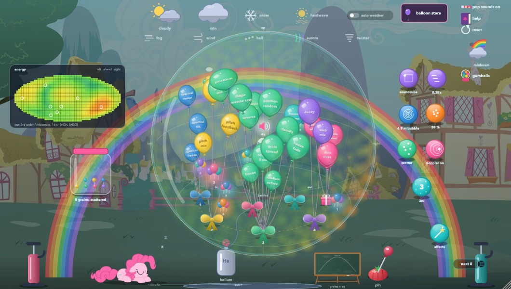

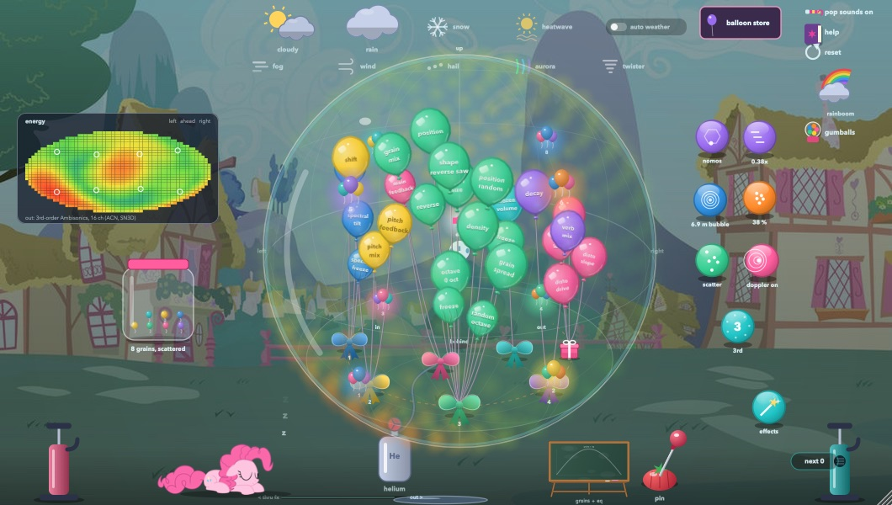

Distance is the size of the bubble you're in, from 1 metre to 50. In a small bubble everything is close and loud and the room answers quickly; in a big one everything is far away, quieter, a little duller and roomier. It sounds the way distance does, after the IEM RoomEncoder: the sound takes longer to arrive from further away (so anything flying towards you or away bends in pitch, like a passing car), and the walls of a room round the bubble answer each sound faintly. Close in, a sound spreads round your head.

The doppler token switches that pitch bend on and off. Off, moving sounds keep their pitch and still get louder and quieter as they come and go.

When it's cloudy the tokens on the right wander too, like a balloon inside a cloud: a little cloud sits on each one while it does. Touch one and it stops.

You can drag a grain while it flies. Let go and it carries on from there.

## Out

Out comes Ambisonics in ACN order with SN3D normalisation, the format the IEM and SPARTA plug-ins use. The order token (bottom right) sets how sharp it is, from 1st to 7th order: 3rd order (the default) is 16 channels, 5th is 36 and 7th is 64. A higher order pins every sound down more sharply, mostly heard on a big dome of loudspeakers. In REAPER, give the track that many channels and put a decoder after it at the same order, such as the IEM AllRADecoder for loudspeakers or the BinauralDecoder for headphones. On a track with too few channels for the order you picked, the highest order that fits comes out, and the map says so.

There is one reverb for the whole sphere (the lilac balloons), built like the IEM FdnReverb: 64 delay lines run on the 16 channels, with the highs dying away faster than the lows. The grains further out send more into it.

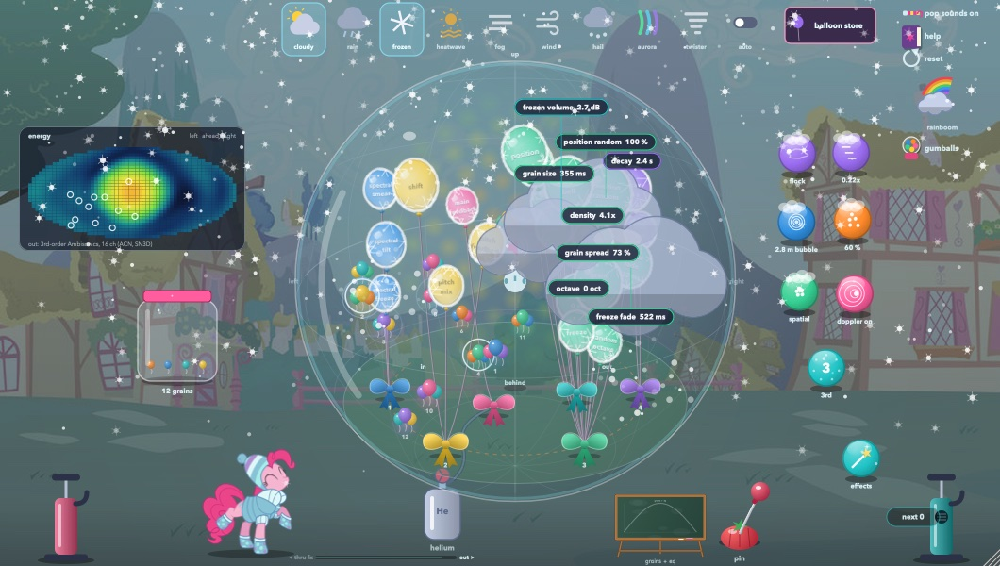

## Colours

Each bunch has its own colour, and so does its bow.

## The effects

Your sound runs through four effects in a row.

First the spectral smear (the blue balloons), which blurs the sound across time. Spectral freeze holds it still. Spectral tilt leans the smear from dark to bright: up lifts the highs and sinks the lows, down does the opposite, and the middle is flat. The smear stays about as loud either way.

Then the pitch shifter. Shift picks the interval, snapped to the scale chosen on the card at the top left, and pitch feedback sends it round again so it keeps climbing.

Then the grains, and a reverb that keeps the low end clean (in the sphere there's one reverb for all the grains together, at the end). That's the order they start in: the order chapter says how to change it.

Each effect has a mix balloon. When a mix balloon is empty, that effect is out of the way.

Main feedback takes the end of the chain back to the start, so the whole shop can ring on by itself. It is tamed so it sings without blowing up.

## Grains

The mint bunch chops your sound into small grains. Grain size sets how long each one is and density sets how many overlap.

Shape is the envelope of each grain. The last shape, chalk, is one you draw yourself on the chalkboard.

Random pan scatters the grains across the stereo field and reverse flips some of them backwards. Octave moves them up or down, or let random octave choose for each grain.

Position picks where in the last four seconds the grains read from, from right now to four seconds back, and position random lets them wander around that spot. Click freeze to hold the sound in place. Freeze fade sets how slowly it slides in and out of the freeze.

These balloons also shape every frozen balloon you catch with the sound pump, even when the effects are bypassed.

## The gumball machine

The gumball machine is sold at the balloon store. Buy it and it comes out in an orange gift box with four balloons, and takes its place on the shelf like the other effects; give it back (or pop one of its balloons) and the sound goes straight past it again.

The orange bunch is a stutter that plays with the whole sound in time with your track (or at its own steady tempo when the track is stopped). On each sixteenth note it may grab the moment and do something with it.

Stutter sets how often that happens. Bounce leans it from plain rolls and flams towards bouncing-ball repeats that speed up until they become a pitch, slowing ones that do the opposite, and frozen buzzing grains. Cut-up lets it pull its sound from other steps of the last bar, so the bar gets rearranged like a breakbeat. Sway holds back every second sixteenth, from a gentle swing to a stumble.

These ideas come from Alexander Mesker's study of Autechre's music: the bouncing ball, the event types, restarting patterns and the swing table.

Now and then a pluck from the pop pump bounces too.

## The order

The sound goes through the effects from left to right, from in to out: the spectral smear (blue), pitch (yellow), grains (mint), reverb (lilac) and a gift box for each effect from the store, the gumball machine (orange) among them.

The order list waits just off the left edge of the window. Move the cursor to the left edge and it slides out, with the effects from top (in) to bottom (out). Drag one up or down to move it: the others make room, and when you let go the bows hop to their new places and the sound follows with a tiny dip so it never clicks. The die at the top rolls a new order. The order is saved with your session.

The loop (main feedback) and the caught sounds stay on the floor: the loop wraps round all the effects.

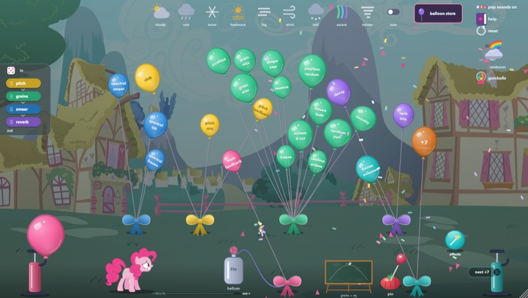

## The pop pump

Hold the pump on the left to blow up a balloon.

While it fills, short plucked saws play on random notes of the scale, slowly and unevenly. Every pluck is folded and panned at random, and its attack is sometimes snappy and sometimes slow. The plucks go through the effects.

Somewhere between 5 and 12 seconds the balloon pops, and every pop is different.

The pop sounds switch at the top right, above help and reset, turns the hiss and the pops on or off. Right-click it to feed them into the effects instead of straight out, so the pops go through the chain with your sound.

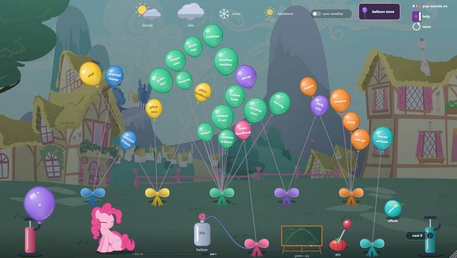

## Catching sounds

Hold the pump on the right to catch a sound in a balloon. It catches what comes out of the effects, or your plain input if you click the catch token beside it. The balloon starts muffled and opens up as it fills. Let go and it floats away, playing what it caught as frozen grains.

You can keep six at once, and the teal frozen volume balloon sets how loud they all are. The badge by the pump shows the pitch of the next one. Click it, or click any caught balloon, to type an interval like +7 or -5, then press return. Scrolling over a caught balloon retunes it along the scale.

To pop one, double-click it, or drag the pin from the tomato cushion onto it.

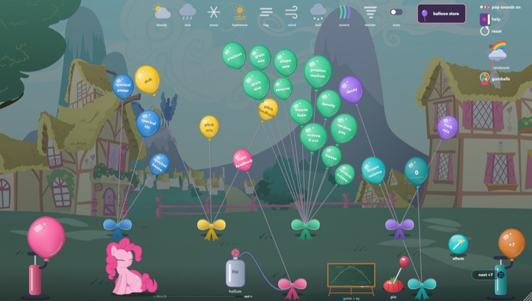

## The canister

Click the helium canister to fill the room with helium. It adds a gentle highpass to the output, and the balloons stretch and float higher.

Slide the canister along its rail to choose where the frozen balloons go. To the right they come straight out. To the left they go back through the effects, so the pitch shifter and the reverb play with them too.

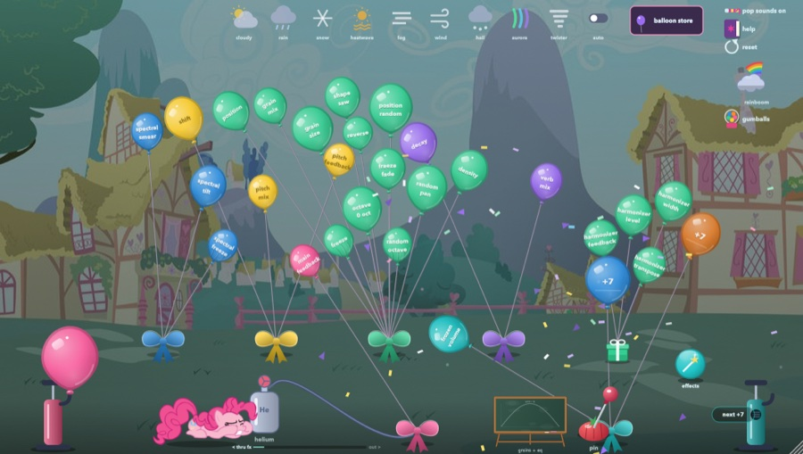

## Weather

The weather switches run along the top of the window: the sun and cloud (cloudy), the rain cloud, the snowflake, the hot sun (heatwave) and auto weather. Click one to turn it on and again to turn it off. Rain and clouds together make a storm.

Rain eases a gentle lowpass onto the output and soaks the balloons.

In the sphere the weather also drifts through the inside of the glass as patches: clouds, rain clouds, snow flurries and heat haze. Any grain a patch passes over gets its settings shaken up at random while it's in there. Snow freezes that grain's spectrum, and the heat smears it.

When it's cloudy, clouds drift through the bouquet, and any balloon inside one slowly wanders to new values, with a little tag showing where it has got to. Clouds bring thunder too, which pulls the rain's lowpass down in slow rolls.

In a storm, lightning strikes now and then and drops a random effect from the store into the room for a minute or so. If you like it, tick it in the store and it stays.

Snow freezes everything over the fade-in time: the sound slows until it stops completely and holds, and the balloons ice over and hang still. It stays frozen until you click the snowflake again, then thaws over the fade-out time. Right-click the snowflake to set both times, anywhere from 5 seconds to 5 minutes: drag along a bar or scroll on it, and double-click puts it back to 5 seconds. Leave Pinkie out in the snow for a minute and she catches a cold; she perks up once the snow has gone.

Snow and a heatwave never come together: turning one on sends the other away.

A heatwave melts the sound into a slow smear over its fade-in time (right-click the hot sun to set its fade in and fade out, like the snow's): whatever you play is spread across many seconds, and the held sound keeps drifting towards whatever comes next, like a stretched recording that never quite stops. The top end softens and swells as the hot air wobbles, gently, nothing like the rain. Pinkie can't take it and flops down flat, and if it rains in the heat she's soaked through.

With auto weather on, the sky looks after itself. Every few minutes the weather turns, the way it does outside: clear skies cloud over, the cloud brings rain or a storm or snow, a long hot spell might end in a summer storm. Each spell lasts somewhere between a minute and twelve, and the dial shows what the sky is doing. You can still flip the switches yourself; auto carries on from there.

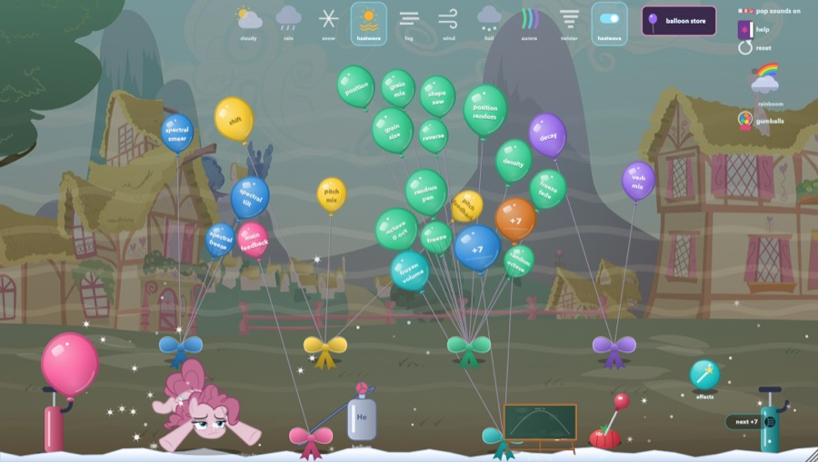

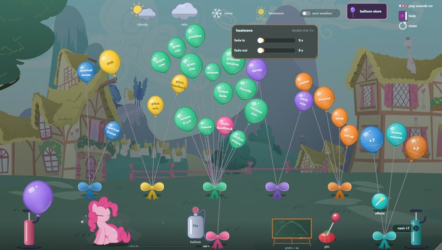

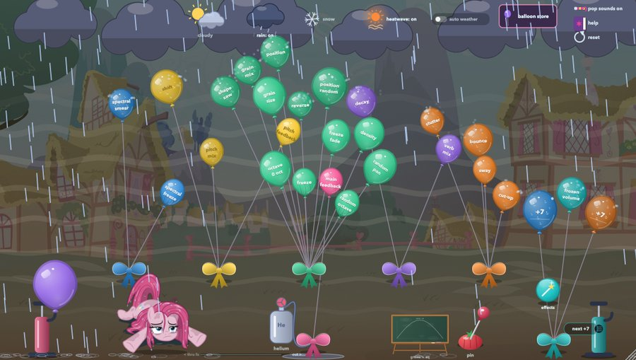

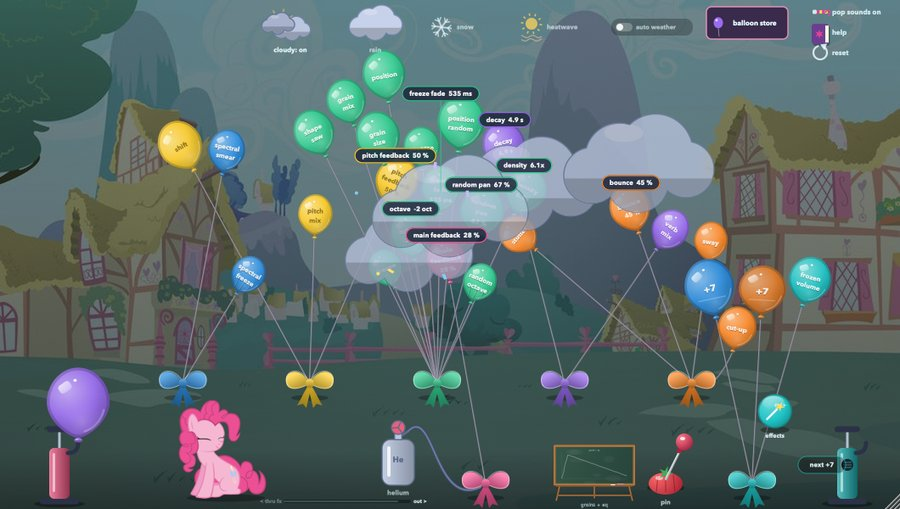

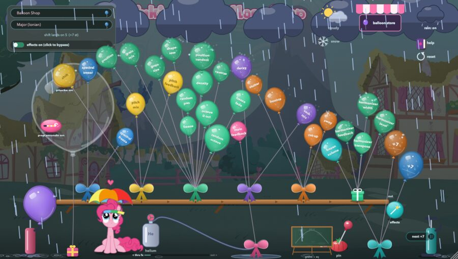

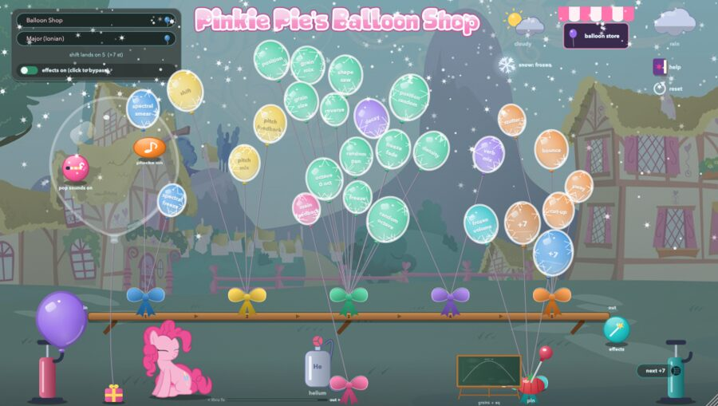

## More weather

Under the first row of weather switches is a second, smaller row: fog, wind, hail, aurora and twister.

Fog blurs every attack. The sound goes through six short echoes too close together to hear apart, so a hit loses its edge without growing a tail, and the highs sink. In the sphere the fog also hides where things are. The whole scene goes a little soft at the edges, and fog banks drift through the ball: a grain inside one comes from all round you instead of from one point, duller and with more of the room on it, until it flies out again.

Wind comes in gusts. The sound is read through a delay that keeps drifting, so its pitch wavers a few cents sharp and flat, up to about a fifth of a semitone in a strong gust. The wind also blows every grain the same way across the sphere, harder in each gust, and the balloons lean over with it. The wind blows the fog away: turning one on sends the other off.

Hail throws hailstones. Each one is a tiny slice of the last moment of your sound, hit hard and then bouncing, quicker and quieter, like a ball dropped on a table. Every stone lands high overhead at its own bearing and bounces its way down to the floor.

The aurora plays your sound an octave up into a long reverb. It hangs in four curtains high up round you. They drift slowly round the sphere, and each one swells and fades by itself.

Twister starts a whirlwind that lasts between 10 and 20 seconds. It takes every grain up into one spiral, a funnel that is narrow at the floor and wide at the top, and the pitch climbs a fifth and falls back while it turns. When it is over the grains fly back to what they were doing. With wind and clouds both on, one comes by itself every few minutes.

The rainbow has no switch. When the rain stops under a clear sky (no clouds, no snow) after at least 20 seconds of rain, a rainbow stands in the sphere for about 25 seconds: seven arcs across one side of the sky, red the lowest sound and the outermost arc, violet the highest and the innermost, each colour arriving a little after the one before.

Auto weather knows all of these. Fog comes after cloud, rain or snow. Wind can blow up a storm. Hail falls out of a storm, and an aurora follows a clear spell.

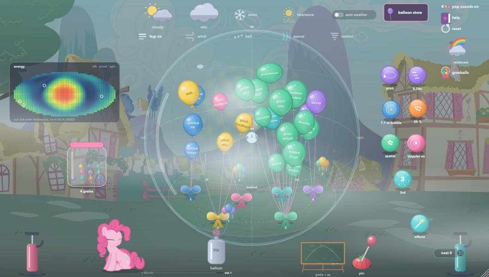

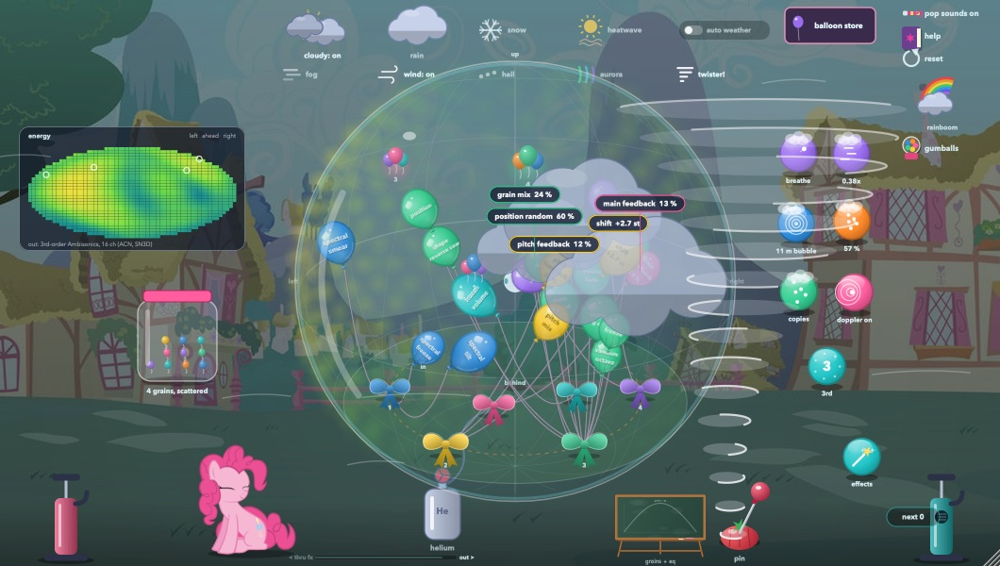

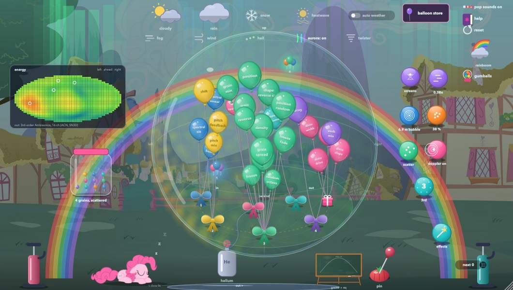

## Sonic rainboom

The little cloud with a rainbow, under help and reset, is the sonic rainboom. Click it and Rainbow Dash dives in from the sky, faster and faster, the rainbow streaming out behind her, until she breaks the sound barrier: a boom and a rainbow at the same moment.

On the way in your sound is squeezed up in pitch, the way a sound rushing towards you would be, with a rush of air under it. The boom has the real shape of a sonic boom, a double crack. Then the rainbow: your sound split into seven colours, red the lowest and violet the highest. They arrive one after another, so they sweep up from the lows to the highs, and each one keeps ringing for the rainbow's length while the rainbow fades from the sky.

The shockwave knocks the balloons back, and the ones nearest it are nudged to new values. Pinkie jumps, amazed.

Fling a balloon hard enough and it breaks the barrier itself: a white cone grows behind it as you get close. Right-click the cloud for what else sets one off, such as a hit in your sound or the rain stopping after a storm. The same menu sets how loud it is and how long the rainbow lasts.

In the sphere it all happens in 3-D. The dive flies in from outside the glass to where it breaks, and the boom comes from there. Then seven rings open out flat round it, red outermost. A ring off to one side sounds like an arc over there; as it passes over you it surrounds you, and then it leaves through the glass. With on fast grains ticked, a grain flying faster than 30 metres a second breaks it where it is.

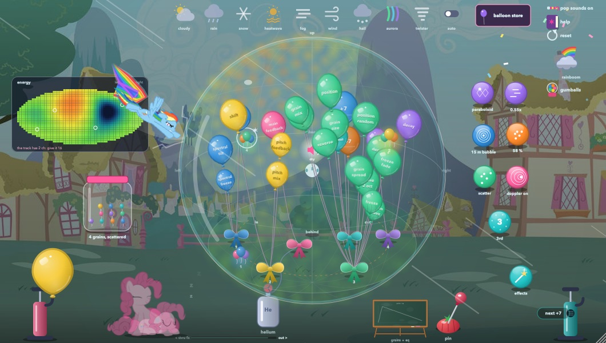

## The balloon store

Click the balloon store sign at the top to open the store. Pick an effect and a little gift box drops out of the shop with four balloons tied to it: its two controls, then its level and its width. The box takes a place among the other effects, and the order list moves it about like the rest. Width spreads the effect from mono in the middle to wide stereo.

Pick a bought effect again to give it back, or pop one of its balloons with the pin. Pop everything sends them all back at once.

The tuned effects in the store follow the scale as well. The ring mod multiplies the sound by a tone, and with follow turned up the tone rises as the sound gets louder.

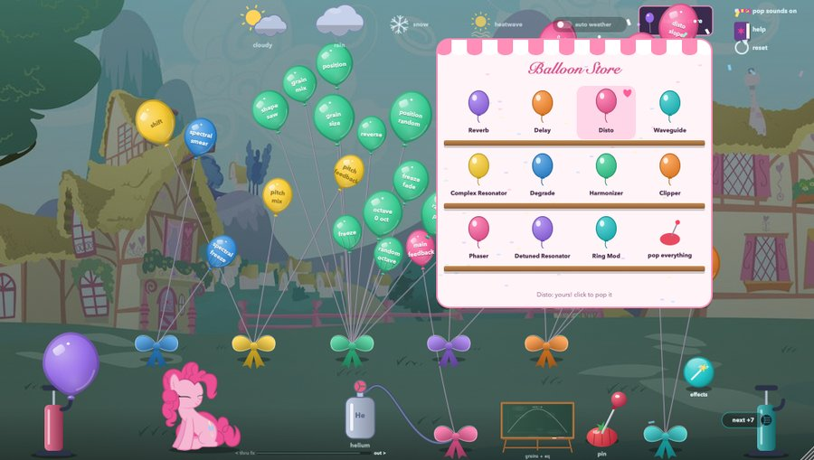

## The gumball menu

Click gumballs, under the rainboom's cloud at the top right, to open the gumball menu. It shows every control in the palace again as a gumball that stays where it is, for when you'd rather not chase a balloon. There is one row for each effect, in its balloons' colour. The sphere's own tokens (flight, speed, distance, deviate, grain mode, doppler, order and how many grains) have a row too.

Each gumball is a glass ball that fills with colour as its value goes up, with the value written inside. Drag one up or down to turn it (hold shift for fine changes), or scroll over it. Click a switch to flip it. Click a setting like shape to step to the next one, or right-click for the one before. Double-click puts a gumball back how it started. Point at one to read its full name and value.

The gumballs and the balloons are the same controls. Turn one and the other follows, and the balloons still work just as they did.

When an effect's balloons come into the room, bought at the store or dropped by the lightning, its row of gumballs pops in here. When they pop, the row pops out. With many effects bought, short rows share a line and the page scrolls.

Click the cross or press escape to go back.

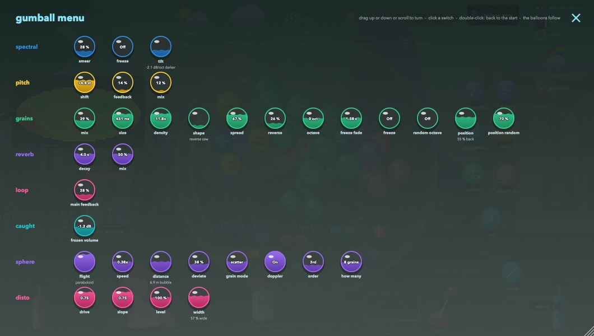

## The chalkboard

Click the little easel on the floor to bring the chalkboard forward. It has two pages, written along the top.

On grain shape, draw across the board to make the life of one grain, from start on the left to end on the right, with loud at the top. Drawing switches the grains to your shape.

On master eq, draw the tone of the whole output. Above the dashed line boosts and below it cuts, with the lows on the left. The pink line shows what you actually hear. The buttons underneath give you ready-made curves, smooth what you drew, or set it flat again.

On master eq the board goes from a deep cut at the bottom to a big boost at the top, 24 dB each way.

Click anywhere outside the board to put it away.

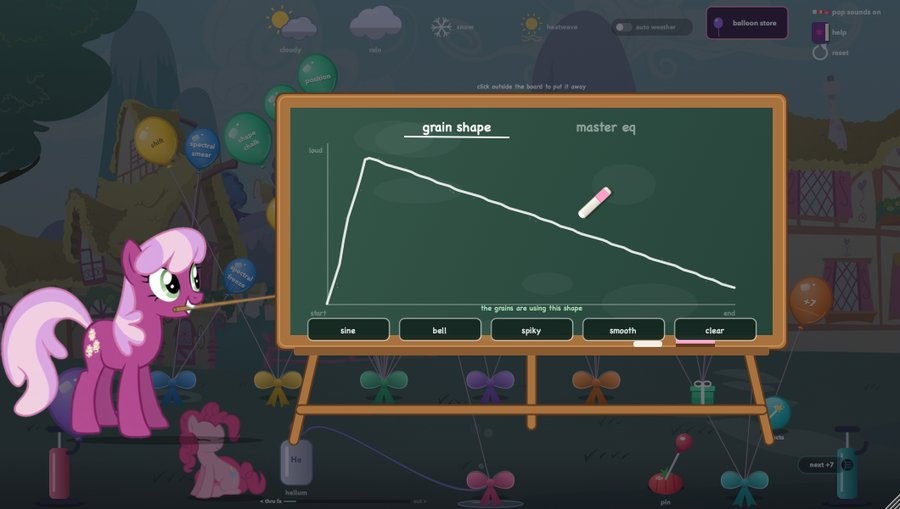

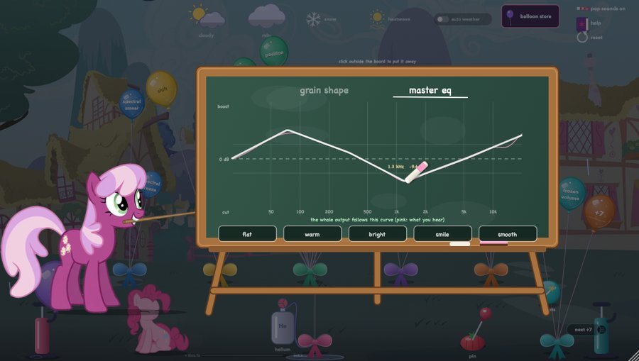

## The card

The card holds the presets and the scale. It waits just above the top left of the window: move the cursor up there and it slides down. Every preset changes the picture behind the shop as well as the sound.

The scale decides which notes the pitch shifter lands on. Everything tuned in the shop follows it.

The reset button under the help book in the top right corner brings everything back to normal: the first preset, a flat EQ, the plain grain shape and the effects in their first order. Caught sounds stay where they are.

The switch underneath the card bypasses the effects, the store's ones included. Only your input and the frozen balloons are left, and the grain balloons still shape them.

## Pinkie

Pinkie sits by the pop pump watching the balloons.

Pops make her jump. When it rains she gets her umbrella out (unless it's a heatwave too: then she lies in the puddle, soaked), and helium turns her to crystal.

Leave the shop alone for a while and she falls asleep.

Every so often, about once an hour, the Great and Powerful Trixie barges in. She zaps balloons from her amulet, each one jumping to a new value, then sets everything she can reach at random with one big flash and leaves. Some visits she also plays a strange synthesised noise into the shop's input, which goes through all the effects, with a chirp for every zap. Sometimes she zaps a few effects from the store into the room too, and those stay. She leaves the bypass and the volume alone, and never touches the snow, the heat or auto weather. If you don't like what she did, the reset button under the help book puts everything back to normal.

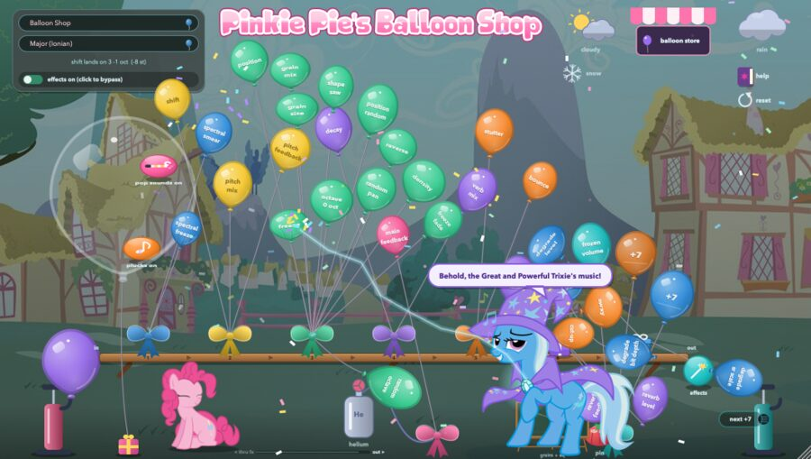
