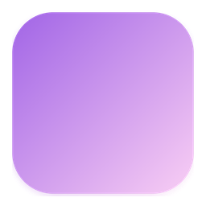
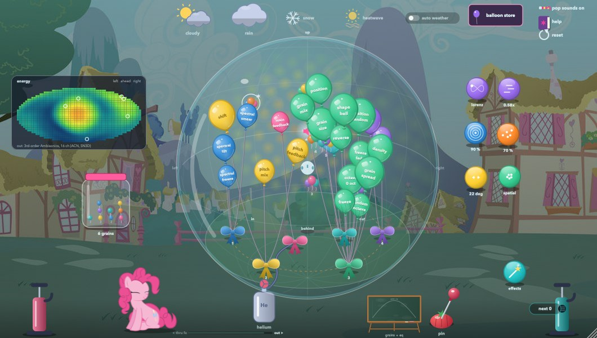

<p align="center"></p>

# Mellyloon: the spatial audio version of Pinkie Pie's Balloon Shop

> **Spatial audio.** Mellyloon is the Ambisonics version (1st to 7th order, 3rd by default) of [Pinkie Pie's Balloon Shop](../README.md), kept in the Balloon Shop's repository (this folder). It is an **encoder**: stereo goes in, Ambisonics come out (ACN order, SN3D, the format of the IEM and SPARTA plug-ins: 16 channels at 3rd order, 36 at 5th, 64 at 7th), and it decodes nothing itself. Route all of them to a decoder of the same order, such as the IEM AllRADecoder for loudspeakers or the BinauralDecoder for headphones. For the ordinary stereo plug-in, see the [Balloon Shop](../README.md).

The same multi-effect you play as balloons, inside a glass sphere you can turn round, with its sound placed in 3-D.

- **Grains.** Little balloon bouquets fly round inside the sphere. Drop them in from the jar (up to 16). Your dry sound plays once, from a loudspeaker you can drag. On *spatial* (the default) every grain carries its own copy of the effects, each copy's sound a point at its grain, its settings deviating from yours and freezing at its own times. On *scatter* there's one copy. On *copies* every grain is the whole shop, dry sound and all.
- **The granulator** works like the IEM GranularEncoder: a cloud of short Hann-windowed mono grains (about 20 at once by default), each born at its own direction round one of the grains and encoded there, with Hermite interpolation and anti-aliased octave-up reads.
- **Flight.** Still, orbit, the Lorenz attractor, a flock (boids), random glides, a spiral, Lissajous loops, the Rossler attractor, breathing in and out, falling, or ping-pong across the sphere, with speed, inside a bubble whose size is the Distance knob (1 m to 50 m). When it's cloudy, the flight, speed, distance, deviate and grains tokens wander by themselves.
- **Distance, after the IEM RoomEncoder.** Every sound is a point with its own propagation delay (so moving sounds Doppler-shift; a switch turns that off and keeps their pitch), 1/r level, a little air absorption and first-order reflections from the walls of a room round the sphere.
- **Weather in the sphere.** Clouds, rain, snow and heat drift through the glass as patches. A grain they pass over has its settings shaken up at random; snow freezes it and the heat smears it.
- **Sonic rainboom.** Something dives in from outside the glass and breaks the sound barrier, at a place it picks, where you fling a balloon, or where a grain is flying fast enough. A double-crack boom comes from that point. Then seven rings, one per colour of your sound (red the lows, violet the highs), open out round it, pass over you and leave through the glass.
- **Any order from 1st to 7th.** The order token picks it: 16 channels at 3rd order (the default), 36 at 5th, 64 at 7th. At 7th order 16 grains take about 31 % of one core, against 23 % at 3rd.
- **One reverb** for the whole sphere, built like the IEM FdnReverb: 64 lines with IEM's prime delay recipe, Hadamard mixing and frequency-dependent decay, run on every channel.
- **An energy map** after the IEM EnergyVisualizer, on the glass and flat at the top left.

Everything else is the Balloon Shop: the order ring, the pumps, the store, the chalkboard, the weather bar, the card, the library and Trixie.

- macOS: Audio Unit, VST3 and a standalone app
- Windows: VST3 and a standalone app
- Linux: VST3, LV2 and a standalone app



**[How to use it: the full help page](docs/HELP.md)** (the same guide is in the plug-in's library: click **help** in the top right corner).

**[The manual (PDF)](docs/manual/Mellyloon%20Manual.pdf)**: installing, routing to a decoder, a map of the window, how the sound flows, the whole guide with pictures, the flight modes, distance and Doppler, every parameter, the presets and answers to common problems. It's also in every download.

## In REAPER with the IEM plug-ins

1. Put Mellyloon on a track and give the track as many channels as the order you want (the track's **Route** button, *Track channels*): 16 for 3rd order (the default), 36 for 5th, 64 for 7th. The **order** token in the plug-in (bottom right) picks the order, from 1st to 7th.
2. After it, add a decoder for your speakers or headphones at the same order, for example IEM **AllRADecoder** or **BinauralDecoder** (normalisation SN3D), and the IEM **EnergyVisualizer** if you like.

On a track with too few channels for the order you picked, the highest order that fits comes out, and the plug-in's map says so.

## Download

Mellyloon's releases are tagged `mellyloon-v...` on the [Balloon Shop's Releases page](https://github.com/femifleming/PinkiePiesBalloonShop/releases), separate from the shop's own:

| System | File |
| --- | --- |
| macOS 11 or later (Apple silicon and Intel) | `Mellyloon-macOS.zip` (Audio Unit, VST3, app) |
| Windows 10 or later (64-bit) | `Mellyloon-Windows.zip` (VST3, app) |
| Linux (x86-64) | `Mellyloon-Linux.tar.gz` (VST3, LV2, app) |

Install it the way the [Balloon Shop's README](../README.md#install) describes, with `Mellyloon` in place of `Pinkie Pies Balloon Shop` (on macOS: the `.component` to `~/Library/Audio/Plug-Ins/Components`, the `.vst3` to `~/Library/Audio/Plug-Ins/VST3`, then `xattr -dr com.apple.quarantine` on both, since the builds aren't notarised). The manual has the steps for every system.

## Build it yourself

You need CMake 3.22 or later and a C++20 compiler (Xcode on macOS, Visual Studio 2022 on Windows, GCC or Clang on Linux):

```sh
git clone --recursive https://github.com/femifleming/PinkiePiesBalloonShop.git
cd PinkiePiesBalloonShop
cmake -S Mellyloon -B build-mellyloon -DCMAKE_BUILD_TYPE=Release
cmake --build build-mellyloon --config Release --target Mellyloon_All
```

It uses the shop's JUCE (the `JUCE` submodule) and the shop's pictures (`Resources`), so it needs the whole repository, not this folder alone. On macOS and Windows the build also copies the plug-ins into your user plug-in folders (turn that off with `-DMELLYLOON_COPY_AFTER_BUILD=OFF`); it appears in your DAW as **Mellyloon** under **FreakiePie**. Linux needs the JUCE dependencies listed in the [Balloon Shop's README](../README.md#build-it-yourself).

With `-DMELLYLOON_BUILD_TESTS=ON` you also get three test programs: `MellyloonSphereTest` checks the spatial side (the harmonics against the AmbiX definition, every channel of the output, distance and Doppler, the granulator, the reverb, every flight mode with 16 grains, and the CPU), `MellyloonTest` the effect chain, and `MellyloonHostTest` drives the whole interface headlessly, saving screenshots (`SPHERE_SHOTS=<folder>` saves a set of views of the sphere).

## How it works

- Spatial mode: each copy of the effects gives out only its effects' sound (its output minus the dry part it passed, sample by sample), and that is a single point at its grain, so every copy is a point you can find. The dry sound is encoded once, at the source. With several copies each is turned down by 1 / sqrt(N).
- Inside the sphere the higher orders fade as a sound nears the middle, so it spreads round you, and it gets up to 6 dB louder there. As things move, their 16 gains glide across each block; each granulator grain keeps its direction for its whole life, as in IEM's.
- The master weather filters, snow, heatwave, EQ, leveler and limiter run on every channel, the leveler and limiter linked. Snow and the heatwave resynthesise each channel separately, which makes a frozen scene diffuse.
- On an Apple M2 Max, 16 grains in spatial mode take about 20 to 24 % of one core at 48 kHz (measured by the sphere test).

## Human contributions

Mellyloon's code was written with Claude Code (Anthropic), working under the direction of its author, [femifleming](https://github.com/femifleming). This is what the author brought to it:

- **The concept.** A spatial version of the Balloon Shop that feels exactly like it, with the balloons in a sphere you can turn. Stereo goes in, and it encodes 16 channels for a decoder.
- **The references.**
  - The IEM plug-ins, SPARTA and SPAT for how it should work.
  - The IEM EnergyVisualizer for the meter.
  - The IEM GranularEncoder and FdnReverb as the bar for sound quality.
  - The RoomEncoder and s3g-dsp for distance.
- **Grains as copies of the effects.** Up to 16 grains, each with its own copy of the effects and its own deviated modulation, flying through the whole inside of the sphere. There is also an option for plain random grains, and one shared reverb.
- **Third-order Ambisonics only.** The author dropped the binaural mode for a separate decoder. They tested it in REAPER through an IEM decoder and asked for the encoding to be checked when they heard phasing.
- **Distance, not width.** The sound is 360 degrees at all times, so spread became distance, from 1 to 50 m, "a small bubble vs a large bubble", with a Doppler switch.
- **More motion.** More flight modes, all moved by the clouds as well.
- **The view.** Balloons fly into the globe when you release them, the sphere zooms, and the background blurs and darkens as you zoom in, at a smooth frame rate.
- **The name.** "Mellyloon", clearly labelled an encoder and kept in the Balloon Shop repo.
- **Listening fixes.** The author found frozen balloons too quiet and asked for the gain staging to be audited.

## Credits and notes

- This is an unofficial fan project, not affiliated with or endorsed by Hasbro. My Little Pony and its characters are trademarks of Hasbro. The character pictures and backgrounds are fan-made, as is the "Magic is Friendship" title font, and they belong to their creators. The flying Rainbow Dash is by Nightmare Moon.
- The ambisonic conventions follow the IEM Plug-in Suite and SPARTA; the energy map follows the IEM EnergyVisualizer. The source-spread and distance ideas were checked against s3g-dsp. No code from these is included.
- The balloon-store effects are rebuilt from Olivier Bélanger's SoundGrain; the gumball machine, the ring mod and the bouncing plucks take their ideas from Alexander Mesker's thesis on Autechre (Macquarie University, 2007).
- Built with [JUCE](https://juce.com).

## License

The code is released under the GNU Affero General Public License v3 (see [LICENSE](LICENSE)), as JUCE's free licence requires. The artwork is not covered by it (see above).
