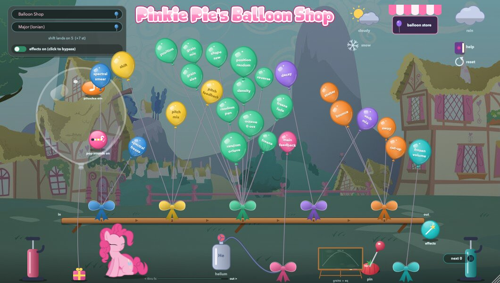
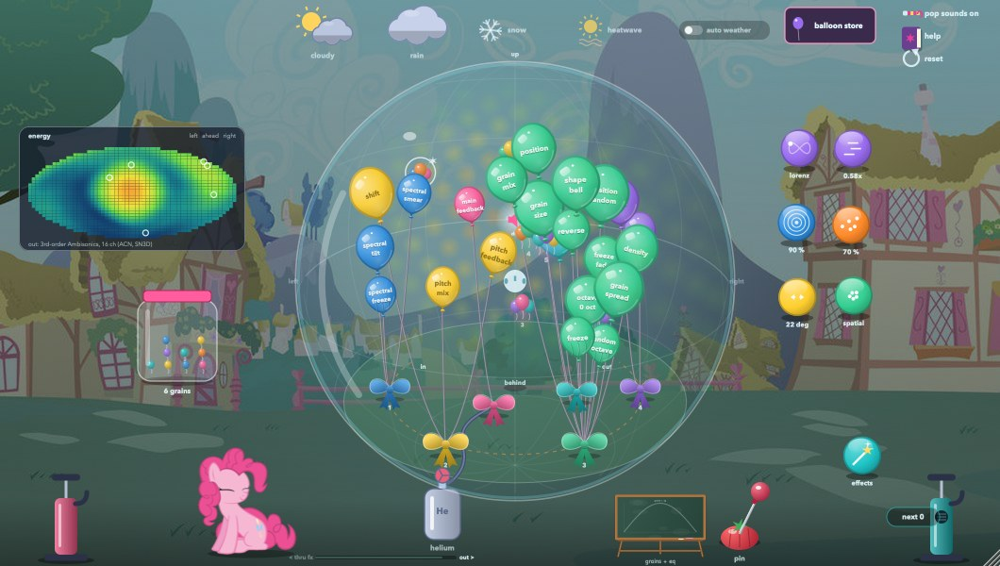

<p align="center"></p>

# pinkie pie's balloon shop

A multi-effect you play as balloons. Every balloon is a control, and how full it is shows its value.

Your sound goes through the effects in the order you set: move the cursor to the left edge and the order list slides out, then drag the effects up or down. The weather changes the sound too: rain softens it, clouds bring thunder and lightning, snow freezes it solid and a heatwave melts it into a slow smear (right-click the snow or the heatwave to set how slowly they come and go). The same row has fog that blurs every attack, wind that bends the pitch in gusts, hail that bounces slices of the sound, an aurora ringing an octave up and a twister; a rainbow follows a shower. A little cloud sets off a sonic rainboom: something dives in until it breaks the sound barrier, and your sound bursts into a rainbow of seven colours (fling a balloon hard enough and it does it too). Pumps blow up plucked notes or catch sounds into frozen balloons, and a chalkboard lets you draw grain shapes and a master EQ. If you would rather not chase balloons, the gumball menu shows every control again as a gumball that stays put. The preset and scale card waits above the top left corner until you reach for it, and every so often the Great and Powerful Trixie drops by.

- macOS: Audio Unit, VST3 and a standalone app
- Windows: VST3 and a standalone app
- Linux: VST3, LV2 and a standalone app



> **Spatial audio version: [Pinkie Pie's Balloon Palace](BalloonPalace/README.md).** The same shop inside a glass sphere, as an Ambisonics encoder (1st to 7th order, 16 channels at 3rd order up to 64 at 7th, ACN/SN3D, for the IEM and SPARTA decoders): grains fly round you, every sound is a point you can find, with distance, Doppler and a 64-line spatial reverb. It lives in the [`BalloonPalace`](BalloonPalace) folder of this repository.
>
> 

**[How to use it: the full help page](docs/HELP.md)** (the same guide is in the plug-in's library: click **help** in the top right corner).

**[The manual (PDF)](docs/manual/Pinkie%20Pies%20Balloon%20Shop%20Manual.pdf)**: installing, a map of the window, how the sound flows, the whole guide with pictures, every parameter, the store's effects, the presets and answers to common problems. It's also in every download.

## Download

Get the latest version from the [Releases page](https://github.com/femifleming/pinkiepiesballoonshop/releases/latest):

| System | File |
| --- | --- |
| macOS 11 or later (Apple silicon and Intel) | [PinkiePiesBalloonShop-macOS.zip](https://github.com/femifleming/pinkiepiesballoonshop/releases/latest/download/PinkiePiesBalloonShop-macOS.zip) |
| Windows 10 or later (64-bit) | [PinkiePiesBalloonShop-Windows.zip](https://github.com/femifleming/pinkiepiesballoonshop/releases/latest/download/PinkiePiesBalloonShop-Windows.zip) |
| Linux (x86-64) | [PinkiePiesBalloonShop-Linux.tar.gz](https://github.com/femifleming/pinkiepiesballoonshop/releases/latest/download/PinkiePiesBalloonShop-Linux.tar.gz) |

## Install

### macOS with Homebrew

```sh
brew tap femifleming/tap
brew trust --tap femifleming/tap      # recent Homebrew asks you to trust a tap first
brew install --cask femifleming/tap/pinkiepiesballoonshop
```

If you installed it by hand before, add `--force` to the last line so Homebrew can replace those copies.

This puts the app in `/Applications` and the Audio Unit and VST3 in `~/Library/Audio/Plug-Ins`. Update with `brew upgrade --cask pinkiepiesballoonshop`, remove with `brew uninstall --cask pinkiepiesballoonshop`.

### macOS by hand

1. Unzip `PinkiePiesBalloonShop-macOS.zip`.
2. Copy `Pinkie Pies Balloon Shop.component` to `~/Library/Audio/Plug-Ins/Components` and `Pinkie Pies Balloon Shop.vst3` to `~/Library/Audio/Plug-Ins/VST3`. Put the app anywhere you like, such as `/Applications`.
3. The builds aren't notarised by Apple, so macOS may refuse to open them the first time. Open Terminal and run:
   ```sh
   xattr -dr com.apple.quarantine ~/Library/Audio/Plug-Ins/Components/"Pinkie Pies Balloon Shop.component" ~/Library/Audio/Plug-Ins/VST3/"Pinkie Pies Balloon Shop.vst3" "/Applications/Pinkie Pies Balloon Shop.app"
   ```
4. In your DAW, rescan plug-ins. In Ableton Live: Settings > Plug-ins, turn on *Use Audio Units v2* and/or *Use VST3 Plug-in System Folders*, then press Rescan. It appears under **FreakiePie**.

### Windows

1. Unzip `PinkiePiesBalloonShop-Windows.zip`.
2. Copy `Pinkie Pies Balloon Shop.vst3` to `C:\Program Files\Common Files\VST3`.
3. Rescan plug-ins in your DAW. The standalone `Pinkie Pies Balloon Shop.exe` runs from anywhere. Windows SmartScreen may warn you the first time because the build isn't signed: choose *More info* > *Run anyway*.

### Linux

1. Unpack: `tar -xzf PinkiePiesBalloonShop-Linux.tar.gz`
2. Copy the plug-ins into your user folders:
   ```sh
   mkdir -p ~/.vst3 ~/.lv2
   cp -r "Pinkie Pies Balloon Shop/Pinkie Pies Balloon Shop.vst3" ~/.vst3/
   cp -r "Pinkie Pies Balloon Shop/Pinkie Pies Balloon Shop.lv2" ~/.lv2/
   ```
3. Rescan in your DAW (most Linux DAWs look in these folders). The standalone app runs with `"./Pinkie Pies Balloon Shop"` and uses ALSA or JACK.

## Build it yourself

You need CMake 3.22 or later and a C++20 compiler (Xcode on macOS, Visual Studio 2022 on Windows, GCC or Clang on Linux).

```sh
git clone --recursive https://github.com/femifleming/pinkiepiesballoonshop.git
cd PinkiePiesBalloonShop
cmake -B build -DCMAKE_BUILD_TYPE=Release
cmake --build build --config Release --target BalloonShop_All
```

On macOS and Windows the build also copies the plug-ins into your user plug-in folders (turn that off with `-DBALLOONSHOP_COPY_AFTER_BUILD=OFF`). On Linux, install the JUCE dependencies first:

```sh
sudo apt-get install libasound2-dev libjack-jackd2-dev libfreetype-dev libfontconfig1-dev libx11-dev libxcomposite-dev libxcursor-dev libxext-dev libxinerama-dev libxrandr-dev libxrender-dev libxi-dev libegl-dev libgl1-mesa-dev
```

The tests (`-DBALLOONSHOP_BUILD_TESTS=ON`) check the sound and drive the whole interface headlessly, saving screenshots as they go.

## Human contributions

Pinkie Pie's Balloon Shop's code was written with Claude Code (Anthropic), working under the direction of its author, [femifleming](https://github.com/femifleming). This is what the author brought to it:

- **The original plug-in.** It started as *FreakiePie*: a live multi-effect with a spectral smear, a scale-quantised pitch shifter with feedback, a live granulator, a 500 Hz high-passed FDN reverb and a master feedback loop. It had a sad, tired Pinkie Pie theme and La Monte Young's *Well-Tuned Piano* scale.
- **Balloons as the instrument.** Every control is a balloon in one bouquet, with its name on it. Drag balloons down and they float back up. A pin pops them, and a hand pump catches sound into frozen granular balloons that stay until you pop them.
- **The weather.** Rain adds a low-pass and helium a high-pass. Clouds bring thunder, lightning and random effect balloons. Snow fades into a spectral freeze over 5 s to 5 min. The heatwave is a slow, Paulstretch-like smear, and auto weather changes by itself. More weather was asked for later: fog, wind, hail, an aurora, a twister and a rainbow after rain.
- **The gumball menu.** A second way to reach every balloon's control: a page of gumball knobs that stay where they are, chosen from rendered options as a filling glass ball in rows by effect, with a store effect's gumballs popping in and out as its balloons do.
- **The references.** The store's effects come from SoundGrain's FX balls. Alexander Mesker's thesis on Autechre was handed over as a source of ideas, and the sonic rainboom comes from *My Little Pony: Friendship Is Magic*.
- **The cast and the pictures.** The author supplied the character pictures, the preset backgrounds and the library background.
  - Pinkie's moods for rain, snow, heat, fright, sleep and the crystal look.
  - Twilight studying in the help library.
  - A pony waiting by the chalkboard.
  - Trixie's rare visits.
- **The name, title font and icon.** From "Balloon Shoppe" to "Pinkie Pie's Balloon Shop", with the *Friendship is Magic* font and a plain gradient icon.
- **Sound decisions.**
  - Western scales back alongside the microtonal ones.
  - Random wave-folded saw plucks for the inflate sound.
  - An EQ range of +-24 dB and FFT sizes up to 16384.
  - An output that never clips.
  - The default patch.
- **Layout, by choosing and testing.** The author chose the store look, the film-strip preset card and the slide-out drag-to-reorder list from mock-ups. They asked for menus to sit above the balloons and clouds, and rejected several redesigns.
- **The release.** Builds for macOS, Windows and Linux, a README, help, a Homebrew install and PDF manuals.

## Credits and notes

- This is an unofficial fan project, not affiliated with or endorsed by Hasbro. My Little Pony and its characters are trademarks of Hasbro. The character pictures and backgrounds are fan-made, as is the "Magic is Friendship" title font, and they belong to their creators. The flying Rainbow Dash is by Nightmare Moon.
- The balloon-store effects are rebuilt from Olivier Bélanger's SoundGrain (the phaser replaces its flanger).
- The gumball machine, the ring mod and the bouncing plucks take their ideas from Alexander Mesker's thesis *Analysis and recreation of key features in selected Autechre tracks from 1998-2005* (Macquarie University, 2007).
- Built with [JUCE](https://juce.com).

## License

The code is released under the GNU Affero General Public License v3 (see [LICENSE](LICENSE)), as JUCE's free licence requires. The artwork is not covered by it (see above).

## Request log

Everything that was asked for while this was designed and built is in [REQUESTS.md](REQUESTS.md).
