# Pinkie Pie's Balloon Shop: help

This is the same guide you'll find inside the plug-in: click the little purple book under the rain cloud to open the library, where Twilight reads in the corner.

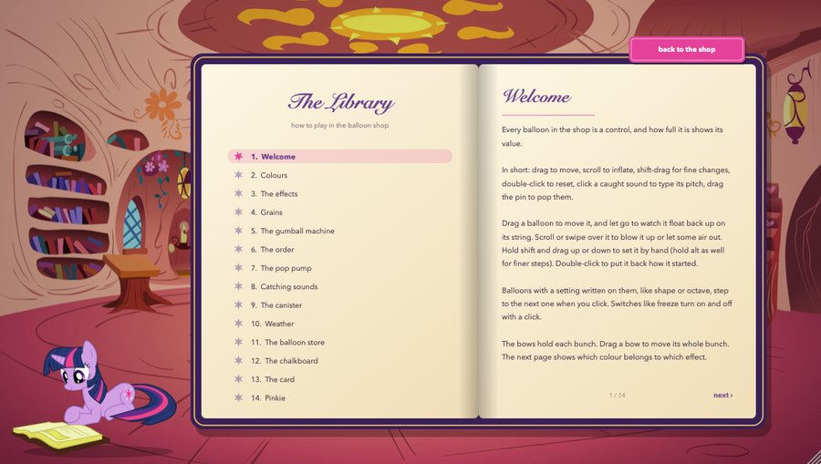

## Contents

- [Welcome](#welcome)
- [Colours](#colours)
- [The effects](#the-effects)
- [Grains](#grains)
- [The gumball machine](#the-gumball-machine)
- [The shelf](#the-shelf)
- [The pop pump](#the-pop-pump)
- [Catching sounds](#catching-sounds)
- [The canister](#the-canister)
- [Weather](#weather)
- [The balloon store](#the-balloon-store)
- [The chalkboard](#the-chalkboard)
- [The card](#the-card)
- [Pinkie](#pinkie)

## Welcome

Every balloon in the shop is a control, and how full it is shows its value.

In short: drag to move, scroll to inflate, shift-drag for fine changes, double-click to reset, click a caught sound to type its pitch, drag the pin to pop them.

Drag a balloon to move it, and let go to watch it float back up on its string. Scroll or swipe over it to blow it up or let some air out. Hold shift and drag up or down to set it by hand (hold alt as well for finer steps). Double-click to put it back how it started.

Balloons with a setting written on them, like shape or octave, step to the next one when you click. Switches like freeze turn on and off with a click.

The bows hold each bunch. Drag a bow to move its whole bunch. The next page shows which colour belongs to which effect.

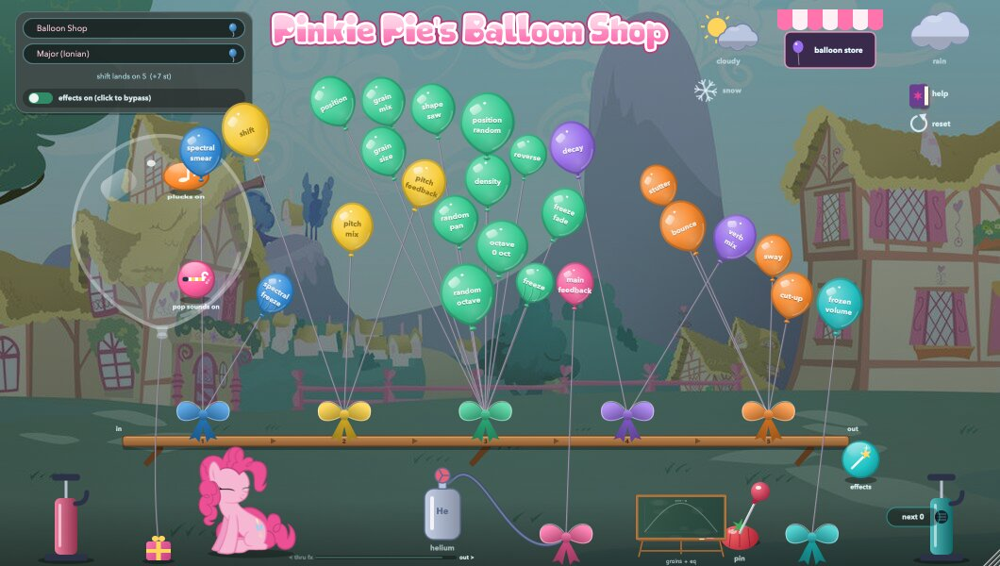

## Colours

Each bunch has its own colour, and so does its bow.

- 🔵 blue: the spectral smear
- 🟡 yellow: the pitch shifter
- 🟢 mint: the grains
- 🟣 lilac: the reverb
- 🟠 orange: the gumball machine (stutter)
- 🩷 pink: the loop (main feedback)
- 🩵 teal: caught sounds

## The effects

Your sound runs through four effects in a row.

First the spectral smear (the blue balloons), which blurs the sound across time. Spectral freeze holds it still.

Then the pitch shifter. Shift picks the interval, snapped to the scale chosen on the card at the top left, and pitch feedback sends it round again so it keeps climbing.

Then the grains, and last a reverb that keeps the low end clean. That's the order they start in: the shelf chapter says how to change it.

Each effect has a mix balloon. When a mix balloon is empty, that effect is out of the way.

Main feedback takes the end of the chain back to the start, so the whole shop can ring on by itself. It is tamed so it sings without blowing up.

## Grains

The mint bunch chops your sound into small grains. Grain size sets how long each one is and density sets how many overlap.

Shape is the envelope of each grain. The last shape, chalk, is one you draw yourself on the chalkboard.

Random pan scatters the grains across the stereo field and reverse flips some of them backwards. Octave moves them up or down, or let random octave choose for each grain.

Position picks where in the last four seconds the grains read from, from right now to four seconds back, and position random lets them wander around that spot. Click freeze to hold the sound in place. Freeze fade sets how slowly it slides in and out of the freeze.

These balloons also shape every frozen balloon you catch with the sound pump, even when the effects are bypassed.

## The gumball machine

The orange bunch is a stutter that plays with the whole sound in time with your track (or at its own steady tempo when the track is stopped). On each sixteenth note it may grab the moment and do something with it.

Stutter sets how often that happens. Bounce leans it from plain rolls and flams towards bouncing-ball repeats that speed up until they become a pitch, slowing ones that do the opposite, and frozen buzzing grains. Cut-up lets it pull its sound from other steps of the last bar, so the bar gets rearranged like a breakbeat. Sway holds back every second sixteenth, from a gentle swing to a stumble.

These ideas come from Alexander Mesker's study of Autechre's music: the bouncing ball, the event types, restarting patterns and the swing table.

Now and then a pluck from the pop pump bounces too.

## The shelf

The effects stand on the long shelf, and the sound goes through them from left to right, from in to out: the spectral smear (blue), pitch (yellow), grains (mint), reverb (lilac), the gumball machine (orange) and a gift box for each effect from the store.

Drag any of them along the shelf. The others shuffle aside to make room, and when you let go the sound follows the new order, with a tiny dip so it never clicks. The numbers on the shelf show the order. It's saved with your session.

The loop (main feedback) and the caught sounds stay on the floor: the loop wraps round the whole shelf.

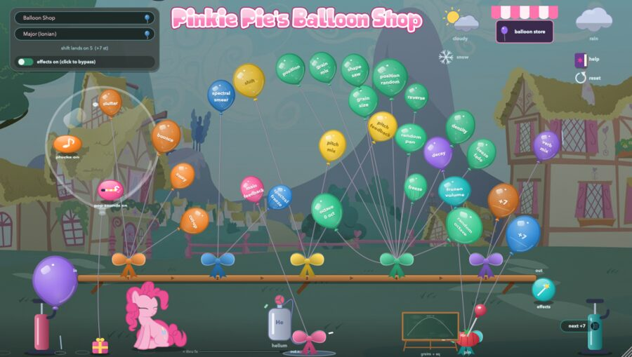

## The pop pump

Hold the pump on the left to blow up a balloon.

While it fills, short plucked saws play on random notes of the scale, slowly and unevenly. Every pluck is folded and panned at random, and its attack is sometimes snappy and sometimes slow. The plucks go through the effects.

Somewhere between 5 and 12 seconds the balloon pops, and every pop is different.

The clear bubble above holds two tokens. Pop sounds turns the hiss and the pops on or off. Plucks turns the plucked notes on or off.

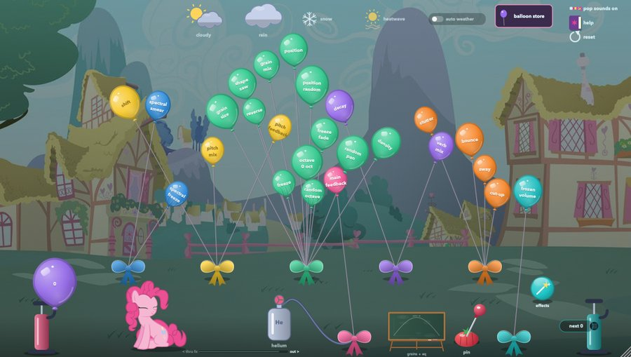

## Catching sounds

Hold the pump on the right to catch a sound in a balloon. It catches what comes out of the effects, or your plain input if you click the catch token beside it. The balloon starts muffled and opens up as it fills. Let go and it floats away, playing what it caught as frozen grains.

You can keep six at once, and the teal frozen volume balloon sets how loud they all are. The badge by the pump shows the pitch of the next one. Click it, or click any caught balloon, to type an interval like +7 or -5, then press return. Scrolling over a caught balloon retunes it along the scale.

To pop one, double-click it, or drag the pin from the tomato cushion onto it.

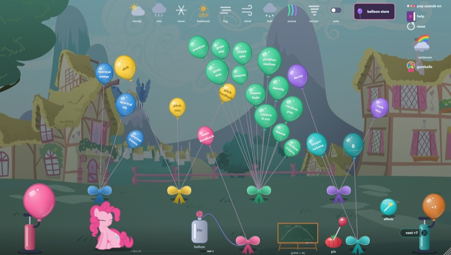

## The canister

Click the helium canister to fill the room with helium. It adds a gentle highpass to the output, and the balloons stretch and float higher.

Slide the canister along its rail to choose where the frozen balloons go. To the right they come straight out. To the left they go back through the effects, so the pitch shifter and the reverb play with them too.

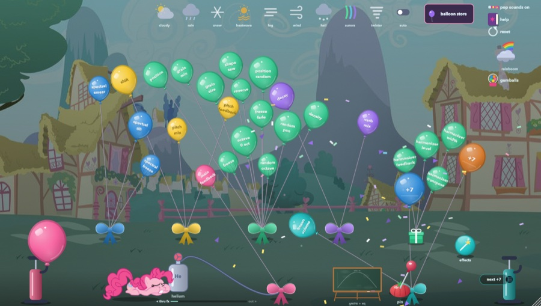

## Weather

Click the cloud at the top right to make it rain. Rain eases a gentle lowpass onto the output and soaks the balloons.

Click the sun to make it cloudy. Clouds drift through the bouquet, and any balloon inside one slowly wanders to new values, with a little tag showing where it has got to. Clouds bring thunder too, which pulls the rain's lowpass down in slow rolls.

Rain and clouds together make a storm. Lightning strikes now and then and drops a random effect from the store into the room for a minute or so. If you like it, tick it in the store and it stays.

Click the snowflake to make it snow. Everything freezes over the fade-in time: the sound slows until it stops completely and holds, and the balloons ice over and hang still. It stays frozen until you click the snowflake again, then thaws over the fade-out time. Both times are written under the snowflake. Drag one up or down, or scroll on it, to set it anywhere from 5 seconds to 5 minutes. Double-click puts it back to 5 seconds.

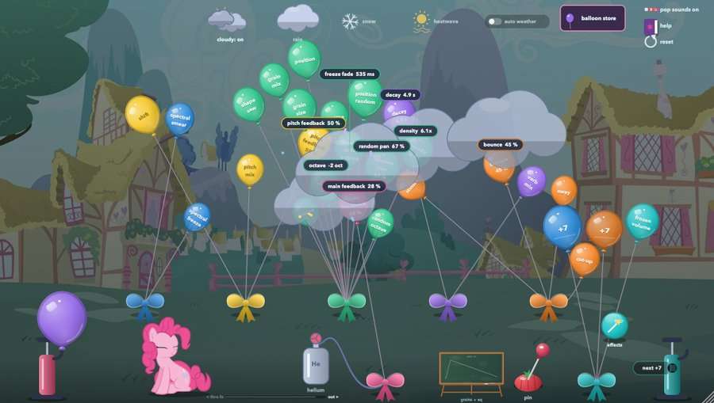

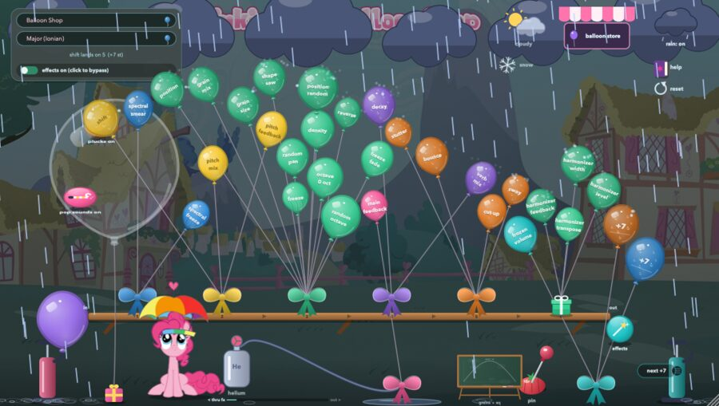

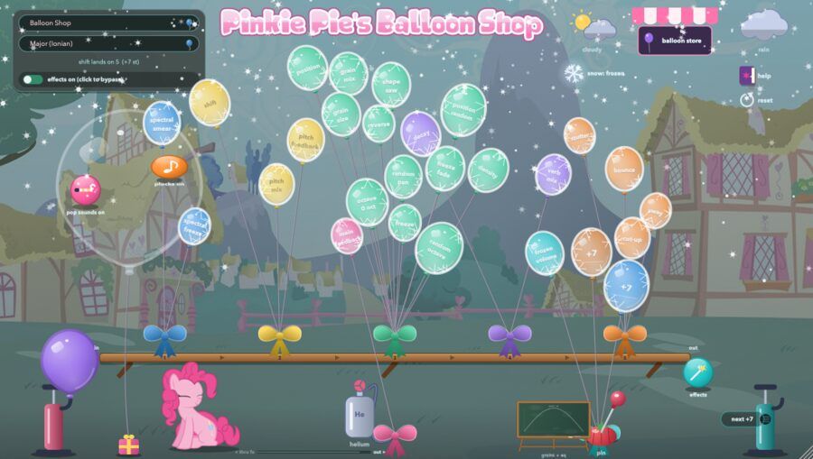

## The balloon store

Click the striped sign to open the store. Pick an effect and a little gift box drops out of the shop with four balloons tied to it: its two controls, then its level and its width. The box takes a place on the shelf like the other effects, so you can drag it to wherever you want it in the sound. Width spreads the effect from mono in the middle to wide stereo.

Pick a bought effect again to give it back, or pop one of its balloons with the pin. Pop everything sends them all back at once.

The tuned effects in the store follow the scale as well. The ring mod multiplies the sound by a tone, and with follow turned up the tone rises as the sound gets louder.

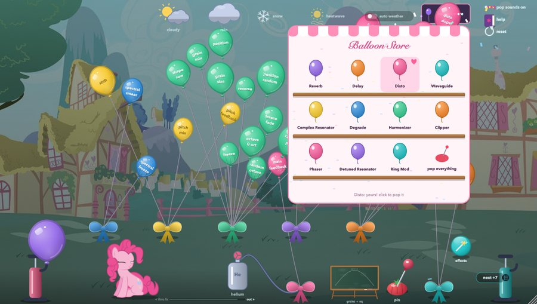

## The chalkboard

Click the little easel on the floor to bring the chalkboard forward. It has two pages, written along the top.

On grain shape, draw across the board to make the life of one grain, from start on the left to end on the right, with loud at the top. Drawing switches the grains to your shape.

On master eq, draw the tone of the whole output. Above the dashed line boosts and below it cuts, with the lows on the left. The pink line shows what you actually hear. The buttons underneath give you ready-made curves, smooth what you drew, or set it flat again.

On master eq the board goes from a deep cut at the bottom to a big boost at the top, 24 dB each way.

Click anywhere outside the board to put it away.

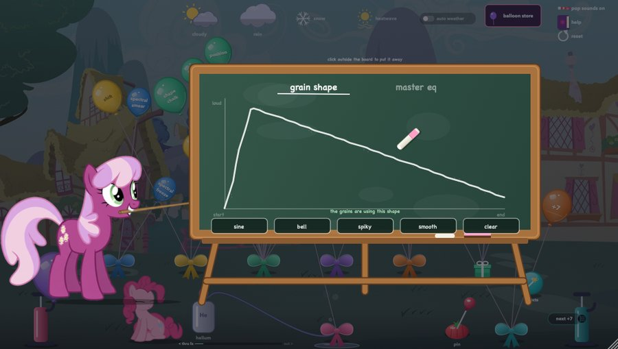

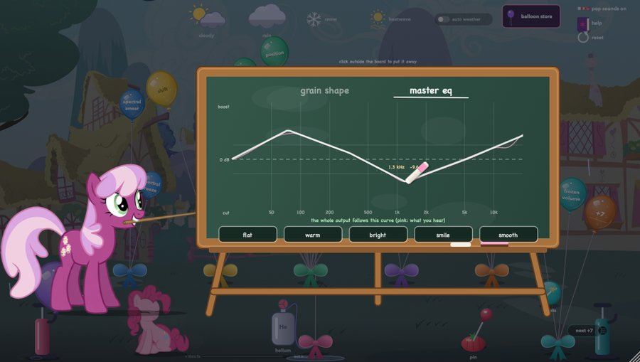

## The card

The card at the top left holds the presets and the scale. Every preset changes the picture behind the shop as well as the sound.

The scale decides which notes the pitch shifter lands on. Everything tuned in the shop follows it.

The reset button under the help book in the top corner brings everything back to normal: the first preset, a flat EQ, the plain grain shape and the shelf in its first order. Caught sounds stay where they are.

The switch underneath the card bypasses the effects, the store's ones included. Only your input and the frozen balloons are left, and the grain balloons still shape them.

## Pinkie

Pinkie sits by the pop pump watching the balloons.

Pops make her jump. When it rains she gets her umbrella out, and helium turns her to crystal.

Leave the shop alone for a while and she falls asleep.

Every so often, about once an hour, the Great and Powerful Trixie barges in. She zaps balloons from her amulet, each one jumping to a new value, then sets everything she can reach at random with one big flash and leaves. Some visits she also plays a strange synthesised noise into the shop's input, which goes through all the effects, with a chirp for every zap. Sometimes she zaps a few effects from the store onto the shelf too, and those stay. She leaves the bypass, the snow and the volume alone. If you don't like what she did, the reset button under the help book puts everything back to normal.

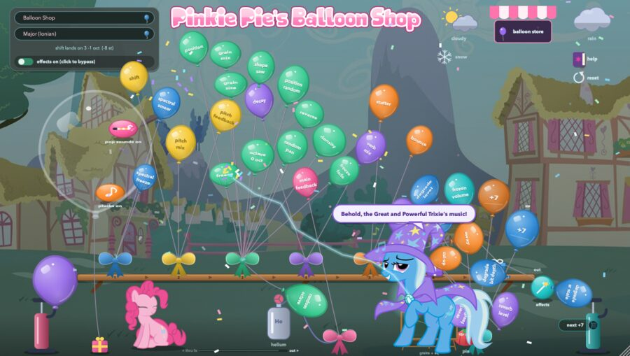

---
[Back to the README](../README.md)
